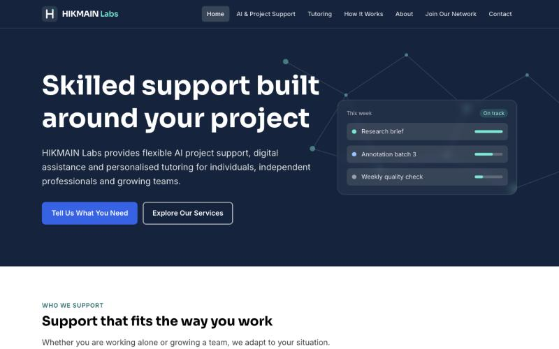

# HIKMAIN Labs — company website

Marketing and lead-capture website for **HIKMAIN Labs Ltd**, a UK company offering AI project support, digital assistance and tutoring. Built from a written client brief and live at **[hikmainlabs.com](https://www.hikmainlabs.com)**.



## What's in it

- **Pages:** Home, AI & Project Support, Tutoring, How It Works, About, Join Our Network, Contact, Policies, and a partner referral page
- **Forms:** contact, contractor application and partner referral, with client-side validation, accessible error messages, and delivery through Formspree
- **Spam protection without CAPTCHAs:** a hidden honeypot field plus a minimum fill-time check; bots get a silent "success" so they learn nothing
- **Referral tracking:** the partner referral form records visitor details before handing off with a tracked `?ref=` link
- **One config file:** every company detail, contact channel and form endpoint lives in `src/config/site.js`, so the header, footer, pages and forms update together
- **SEO:** per-page titles and meta descriptions, Google Search Console verification
- **Polish:** responsive layout, Framer Motion animations, WhatsApp and email contact options

## Tech stack

React 19 · Vite 7 · Tailwind CSS 4 · React Router 7 · Framer Motion · Formspree · Vercel

## Process

Before launch I audited the site against the brief, logged 10 blocking issues, and fixed them through a revision cycle with the client. AI-assisted code was reviewed and corrected before release.

## Run it locally

```bash
npm install
npm run dev      # http://localhost:5173
npm run build    # production build in dist/
```

## Project structure

```
src/
  pages/        one component per route
  components/   layout, UI and form building blocks
  hooks/        useFormSubmit (validation, spam checks, submission), useEmailModal
  config/       site.js — company details, contact channels, form endpoints
  lib/          shared animation settings
```

---

Built by [Muzzammil Suleiman](https://github.com/Muzzammil45).
